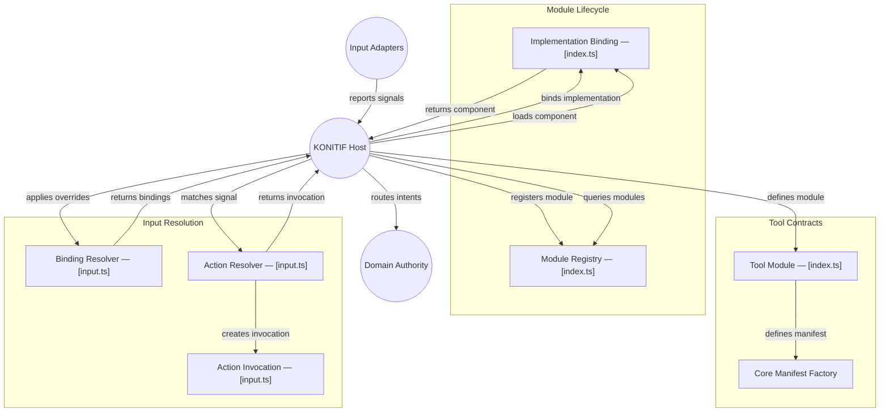

# GitDiagram architecture — @konitif/tools

This architecture view was generated from the public repository by [GitDiagram](https://gitdiagram.com/lemouf/konitif-tools) on 2026-09-20 18:45:57 UTC.

It is a documentation projection of the repository tree, README, and source files sampled by GitDiagram. It does not replace the authored contracts in [catalog.json](catalog.json) and [diagrams.json](diagrams.json), nor does it establish runtime authority.

The Mermaid source keeps GitDiagram's groups, nodes, relationships, and source links. GitDiagram's forced color classes and HTML line breaks are omitted so the diagram remains readable in local previews and dark themes.

- Public repository: [konitif-tools](https://github.com/LeMouf/konitif-tools)
- Interactive diagram: [Open in GitDiagram](https://gitdiagram.com/lemouf/konitif-tools)

## Architecture diagram

## Generated analysis

@konitif/tools is a portable contract library for defining KONITIF tool modules, binding implementations, registering modules, and resolving input signals into action invocations. The principal workflow is host definition, explicit implementation binding, registry admission, then input override and signal resolution before the host routes resulting intents to domain authority. The package does not own UI, device listeners, host state, profiles, or effects. Wiring beyond the sampled TypeScript and README authority boundary is intentionally omitted.
